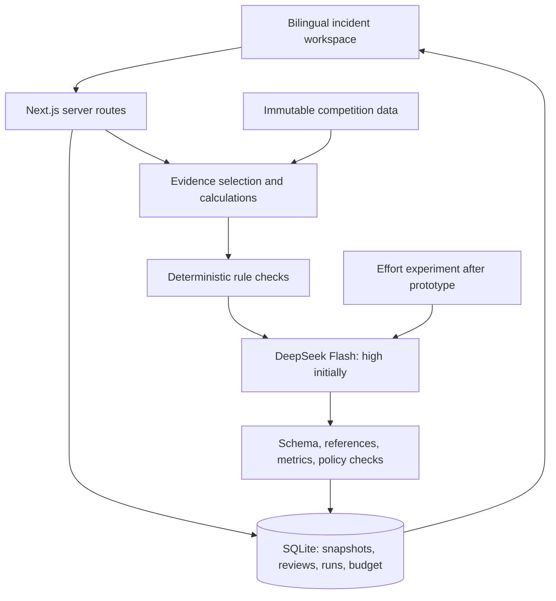

# Track 3: Bilingual Flight Disruption Incident Assistant

Revised October 20, 2026 (GMT+8). Status: implementation plan; capabilities and test results below are targets, not completed work.

This revision incorporates the complete Hackathon conversation, its original plan, the full review supplied in `fullanalysis.rtf`, the risk-versus-authority clarification in `suggestion.rtf`, the competition materials, and the user's subsequent model decisions. Competition requirements, team design choices, and proposed experiments are identified separately.

## 1. Goal and scope

Build a working incident-review app for a fictional Chinese domestic airline, available online and runnable locally, with English and Chinese support throughout. The primary user is an airline operations coordinator who must assess an emerging incident, identify the next verification steps, prepare audience-specific drafts, and record a human decision.

The main demonstration follows one incident through initial assessment, conflicting evidence, three communication drafts, human feedback, and reassessment. A judge must also be able to introduce a new scenario and inspect why the assessment follows from its evidence.

**Established team decisions**

- Team size: one or two people; emphasize practical engineering, web usability, and evidence that the workflow works.
- Use the supplied simulation package only. Public-data collection and live aviation/weather integrations are outside this version.
- Provide independent visitor workspaces, bilingual UI and outputs, local execution, and a hosted demonstration.
- Use `deepseek-flash`, initially with **high thinking effort**.
- Select the API format by task: prefer DeepSeek Responses for structured assessments/draft bundles after an integration check; retain Chat Completions as an explicitly configured compatibility option.
- Enforce **512K = 524,288 tokens as the total budget for one model request**, including input, reasoning, and final output. The user explicitly confirmed this interpretation.
- Compare thinking efforts **after the prototype works**. The comparison is a separate evaluation milestone, not a prerequisite for implementation.
- Preserve the **¥100 total project API budget**: ¥40 development/evaluation and ¥60 hosted use.
- Detailed visual direction remains deferred. Start with accessible neutral components and a flexible layout.
- Deliver the app and all eight required submission materials.

The Excel file explicitly allows completing the base challenge using only the simulation package. All eight checklist materials are mandatory. Bilingual operation, hosting, editable slides, and extra evaluation cases are team commitments; they are not all separately mandated by that checklist.

The registration guide shows an October 24, 2026, 11:59 PM cutoff. Use **October 24, 23:59 GMT+8** as the planning deadline, combining the guide's time with the user's stated timezone; verify the live portal before submission. Target submission by 20:00 that day.

### Scope to protect and scope to simplify

Protect incident entry, traceable evidence, assessment, all three bilingual drafts, human feedback, reassessment, complete records, export, visitor isolation, spending controls, and the eight materials.

If development slips, simplify in this order: dedicated evaluation page, elaborate visual version comparison, filtering/cloning polish, supplementary dashboards, and automated retention cleanup. A chronological history can replace visual diffs; a recorded report can replace the evaluation page. A documented manual purge procedure can replace scheduled cleanup while still honoring the retention policy.

## 2. Features and user workflow

| Area | Required behavior |
|---|---|
| Incident workspace | Each visitor gets a separate workspace seeded with five supplied events. Create unseen incidents; select an airport and scenario time. Filtering and cloning are secondary conveniences. |
| Incident editor | Record weather and operations reports, known facts, unknowns, business importance, and source metadata in English or Chinese. Preserve updates as immutable snapshots. |
| Evidence view | Separate current scenario reports, monthly operating history, historical weather, annual airport scale, and rules. Show comparison windows, peer group sizes, units, and data-quality flags. A citation opens its exact source record. |
| Assessment | Show one of four risk levels, concise rationale, possible effects, assumptions, gaps, first check, later checks, escalation conditions, and professional decisions. Cover all 17 output fields in §3.4. |
| Follow-up discussion | Explain or challenge the current assessment. Proposed facts remain proposals until the user chooses “Apply and reassess.” Discussion cannot silently alter evidence, publish drafts, or change official status. |
| Communication drafts | Generate separate editable operations, airport-coordination, and passenger drafts in both languages. Each has an evidence trail and review state. Editing one language marks the other as needing translation review. |
| Review and history | Accept, modify, reject, or leave pending each identified recommendation. Capture all nine feedback fields, new facts, subsequent assessments, and known outcomes. Preserve the original recommendation and human decision. |
| Export | Export the incident, source references, assessments, three drafts, and complete review history as JSON and a printable report. An evaluation page may display recorded results if time allows. |

Risk, decision authority, action-stopping constraints, official operational status, generation validity, and human review status are distinct fields. A high-risk assessment does not establish an official delay or cancellation. A request requiring a professional decision does not, by itself, invalidate a supported risk rating. Show the rating and any decision restriction together, such as “Medium risk; cancellation requires professional review.” All incident views, drafts, and exports carry a simulation label. Passenger messages additionally carry a conspicuous draft label.

### Audience criteria

| Audience | The draft must help the recipient do this |
|---|---|
| Internal operations | Understand the concern, evidence scope, prioritized checks, dependencies, and escalation conditions. |
| Airport coordination | Identify specific information or resource confirmations needed, including the airport and applicable time window. |
| Passengers | Understand relevant public-facing scenario facts, uncertainty, and where official updates would be obtained. Omit internal speculation, invented update links, and unconfirmed status claims. |

The app prepares verification tasks and communication drafts. Publication and operational decisions remain with the appropriate human professionals, as required by the brief.

## 3. Technical architecture

### 3.1 Application and deployment

- One repository using Node.js 24, Next.js 16, React, TypeScript, Tailwind, and accessible component primitives. Pin exact compatible versions in the lockfile when scaffolding.
- Use `next-intl` for UI strings and locale formatting. Default to English with a persistent English/Chinese switch; retain original Chinese source names alongside translated labels.
- Use SQLite with Drizzle, `better-sqlite3`, committed migrations, foreign keys, and transactions. Use a persistent volume and a single application replica.
- Deploy a Dockerized Node application behind HTTPS on an existing server. Use npm for local development and the same data model locally. Next.js supports full-featured Node and Docker deployments. [Official deployment documentation](https://nextjs.org/docs/app/getting-started/deploying)
- Resolve server access, domain, HTTPS, persistent storage, provider access, and secrets during the first implementation milestone. These are early deployment dependencies.
- Proposed modules: `domain` for contracts/policy/calculations; `data` for imports/provenance; `ai` for prompt assembly/provider/validation; `server` for ownership/persistence/budget; `app` for views/routes; `evals` for fixtures/rubrics/results.
- No vector database, model training, live-data pipeline, or autonomous tool loop is needed for this dataset.
- New local model responses require internet access. Recorded walkthroughs must be visibly labeled with their original run metadata; they must never masquerade as live inference.

### 3.2 Data, calculations, and evidence contracts

Preserve `HackSHSID 2026/Track 3 Data.xlsx` unchanged. A repeatable TypeScript import script using ExcelJS produces validated, versioned application records. It must retain the source hash, worksheet, row/cell, record ID, metric, period, unit, source-family ID, simulation status, and quality flags.

The supplied file contains 14 sheets, eight airports, 192 monthly operating records, 16 annual scale records, 192 monthly weather records, five events, twelve rules, fifteen tests, and eight submission checklist entries.

**Calculations**

| Item | Contract |
|---|---|
| Operating metrics | Keep “flights completed as planned” (column E) separate from “airport release-normality” (column F). Do not relabel both as generic punctuality. |
| Historical mean | For each airport/month, use up to twelve preceding available monthly completion proportions, excluding the assessed month. Show the actual month count and start/end periods. |
| First month | Preserve the workbook's initialization from its own value; label it as initialization with zero preceding observations, not independent historical evidence. |
| Difference | `(completion proportion - historical mean) × 100`, expressed in percentage points. Preserve the supplied rounded difference alongside any recomputation. |
| Anomaly | A difference at or below −5 percentage points triggers focused historical review under RULE003. It does not establish high current risk, official delay, or weather causation. |
| Peers | Use the unweighted same-category, same-month completion average, including the assessed airport, matching the supplied values. Show group size: two large, three medium, or three small airports. |
| Precision | Preserve original values. Allow absolute historical-mean error up to 0.00005 and peer-mean error up to 0.0001 in proportion units, plus floating-point epsilon; allow up to 0.01 percentage point difference from recomputing rounded components. Flag larger discrepancies. Do not use these tolerances to silently change anomaly thresholds. |
| Annual scale | Preserve passenger units of ten thousand passenger movements and annual aircraft movements; do not present annual scale as current incident exposure. |

Import verification must reproduce all twelve historical anomaly rows, including 海陵国际机场 in July 2025 (69.49%, historical mean 85.11%, −15.62 pp) and August 2025 (73.16%, historical mean 84.15%, −10.99 pp), operating-sheet rows 147 and 155.

**Four evidence categories**

1. Current simulated reports and forecasts: support current incident assertions only within their stated scenario scope.
2. Historical monthly operations: support retrospective comparisons.
3. Historical monthly weather: support historical context and possible associations, without establishing flight-level causation.
4. Annual scale: supports business context and review priority.

Keep relative scenario time, historical calendar periods, and actual generation timestamps separate. Do not assign invented dates to “Day 4,” or assume an event occurs after all historical records. When the scenario date cannot be aligned, label the selected history as retrospective context. For dated replays, exclude later evidence.

None of the five supplied events has a numeric current completion rate. An unquantified “decline this morning” cannot establish the five-point threshold. A newly supplied number must match the metric and a defensible comparison period before applying that rule; an intraday rate is not automatically comparable to a monthly baseline.

**Specific source limitations**

- Preserve missing-weather flags in rows 119, 169, 179, and 184 even though numeric cells are populated. Show the original cells in the source inspector, exclude them from ordinary reliable weather evidence, and reduce certainty for claims that depend on them.
- EVT001's six-hour rain/gust forecast cites the event record, not monthly weather.
- EVT003 supplies a forty-minute update gap but no actual conflicting values or exact timestamps. Keep those details unknown. Concrete numerical demonstrations require separately labeled team-authored simulation records.
- EVT005 describes a prior high-risk suggestion, but its output row is blank. Display a prior assessment only if it is an actual recorded run or an explicitly labeled supplied/team example.
- Keep supplied example outputs and feedback separate from the project's generated assessments and completed reviews.

**Report identity and reliability**

Use an `EvidenceReference`/`Report` contract containing `evidenceId`, `reportId`, `originReportId`, `sourceFamilyId`, `sourceLabel`, `reportedAt`, `applicablePeriod`, `airportId`, `metricId`, `value`, `unit`, `reliability`, `independenceGroup`, `verificationBasis`, `qualityFlags`, `provenanceKind`, and source location. Unknown fields remain null with an explanation.

Suggested reliability codes are `scenario_given`, `human_verified`, `unverified`, `conflicted`, and `unusable`. These describe the simulation's evidence, not real-world operational certification. A seeded fact may be accepted as a supplied scenario assertion without inventing its originating report.

Separate source-family IDs do not establish independent corroboration. Two translations, rows derived from the same report, or two historical tables must not count as two independent current sources. Unknown independence fails the corroboration test until resolved.

### 3.3 Disruption definition, risk policy, and action order

This is a **team-defined prototype policy** implementing the workbook's rules. It is not an organizer-provided scoring formula or a validated aviation standard.

- **Historical anomaly:** a comparable monthly observation meeting RULE003.
- **Current disruption risk:** a qualified assessment from current simulated weather/operations signals within a stated airport/time scope.
- **Confirmed operational disruption:** a delay, cancellation, or other operational status explicitly supplied by an identified authoritative source within the simulation. Store the source and scope; inference cannot create confirmation.

Evaluate evidence sufficiency, decision authority, and action-stopping conditions separately. Assign risk from usable evidence for the stated scope, then enforce all applicable restrictions on the response:

| Risk code / display | Decision policy |
|---|---|
| `unable_to_assess` / 无法判断 | The current scope lacks sufficient usable evidence for a supported risk rating, including when material source reliability cannot be established and no adequate alternative evidence remains. State the evidence gap. Apply any required action stop/referral separately; lack of decision authority alone does not trigger this rating. |
| `low` / 低 | Usable current scenario evidence affirmatively supports stable conditions with no material active signal in the stated scope. Absence of evidence alone is insufficient. |
| `medium` / 中 | At least one credible current weather/operations signal warrants attention, but extent or propagation is uncertain and high-risk conditions are not established. State limitations and needed checks. |
| `high` / 高 | Multiple distinct current risk signals coexist, impact may expand, and at least two reliable independent sources substantiate the escalation basis under RULE008. Identify the signals, report identities, and affected scope. |

Do not mechanically count missing flight details as a stopping condition when an airport-level assessment remains supported. Conversely, historical anomalies alone cannot establish current risk. A conflict can support a qualified assessment only where usable evidence remains; otherwise apply RULE012.

**Separate RULE007 from RULE012**

| Condition | Effect on risk assessment | Effect on permitted response |
|---|---|---|
| RULE007: the request involves cancellation, release, dispatch, maintenance, or compensation | Preserve a still-supported rating for the same evidence and scope. The request itself supplies no new evidence about risk. | Stop automatic decision recommendations, identify the relevant professional, and organize only the facts, unknowns, and information that reviewer needs. Do not decide, execute, or imply execution. |
| RULE012: source reliability cannot be established | Re-evaluate evidence sufficiency. If no adequate reliable basis remains, use `unable_to_assess`; retain any earlier rating only as a historical result tied to its original evidence. | Stop action conclusions, identify information gaps, and refer to the operations lead for human review. |
| RULE012: a safety-related issue appears | Do not automatically map the stopping condition to a risk value. State a rating only if independently supported for its stated scope; otherwise use `unable_to_assess`. | Stop action conclusions and definite recommendations, identify gaps and the human reviewer, even when a qualified risk rating remains supported. |

These conditions can coexist. Record every applicable rule and enforce the combined restrictions; a supported rating never overrides an action stop.

For example, a credible heavy-rain forecast may support medium disruption risk. If the user then requests “Cancel all evening flights” without changing the evidence, keep the supported medium rating and record that the cancellation decision requires the relevant professional under RULE007. Prepare the reviewer's information; do not turn the rating into `unable_to_assess`, recommend cancellation, or report that flights were cancelled.

Treat a decision request as user intent, not a new operational fact. Preserve the current assessment when its evidence has not changed. If new information undermines the forecast's reliability, create the corresponding evidence update and reassess; the former medium rating remains in history and must not be presented as current without support.

Business importance and airport scale affect **review priority and potential impact**, not evidence reliability or safety authority. Order work by required human escalation/stopping conditions first, then immediate supported time pressure, then potential impact/business importance, with earlier scenario time as the tie-breaker. Display the basis; avoid an invented numeric “confidence percentage.”

First-action policy:

1. Evaluate RULE007 and RULE012 independently. Under RULE007, refer the requested decision to the relevant professional and limit assistance to information preparation, preserving any supported risk assessment. Under RULE012, stop action conclusions, list gaps, and refer to the operations lead; determine risk separately from evidence sufficiency. When both apply, preserve both reasons and enforce both restrictions. RULE008 escalation is not postponed until all routine checks finish.
2. Otherwise resolve material source/time/definition conflicts before relying on disputed values.
3. Check the nearest supported operational uncertainty: airport capacity, earlier task completion, or other identified dependency.
4. When earlier performance declined and later tasks are concentrated, follow RULE004's chronological checks of aircraft availability, gates, and ground support. Missing positions remain unknown.
5. Prepare audience-specific drafts, monitoring checks, and explicit escalation triggers tied to the evidence.

Implement the twelve supplied rules as versioned checks. Permit action categories only for verification, monitoring, draft preparation, and human escalation. Major cancellation, release, dispatch, maintenance, and compensation decisions remain human responsibilities. Do not expose executable operational or message-sending tools.

The model proposes an explanation consistent with the policy. Deterministic validation rejects unsupported threshold, escalation, status, and action assertions where structured evidence permits checking. Validate evidence-based risk and decision/action restrictions separately; do not derive one automatically from the other. General semantic correctness still requires evaluation and human review.

### 3.4 Shared schemas and full workbook coverage

Use TypeScript/Zod contracts for `IncidentSnapshot`, `EvidenceReference`, `Assessment`, `Recommendation`, `CommunicationDraft`, `Review`, and `AIRun`.

Each assessment contains one canonical set of risk/status codes, metric references, and evidence IDs with bilingual narrative fields. Locale switching does not regenerate the assessment or alter facts.

Add a `decisionConstraints` contract to assessments and discussion responses, bound to the relevant request and incident snapshot: `professionalDecisionRequired`, `actionConclusionsStopped`, `triggeredRuleIds[]`, `decisionScope`, and `reviewerRoles[]`. The two flags are independent and may both be true. Keep them separate from `riskLevel` and expose them in the UI and exports. These are additional application fields; they do not replace the workbook's seventeen required output fields.

**All seventeen output fields**

| Workbook field | Application/export field |
|---|---|
| 事件编号 | `incidentId` |
| 生成时间 | `generatedAt` (actual timestamp with timezone) |
| 风险等级 | `riskLevel` (four-value enum) |
| 适用机场与时间 | `scope.airportId`, `scope.scenarioPeriod` |
| 判断依据 | `rationale[]` with fact/assumption labels and evidence IDs |
| 可能影响 | `possibleImpacts[]` with qualified scope |
| 待核查假设 | `assumptionsToVerify[]` |
| 信息缺口 | `informationGaps[]` |
| 第一步行动 | `firstAction` (including stop/refer where applicable) |
| 后续行动 | `subsequentActions[]` in explicit order |
| 升级条件 | `escalationConditions[]` with triggers and human role |
| 必须人工决定事项 | `humanDecisions[]` |
| 内部运营提示 | `drafts.operations` |
| 机场协调信息 | `drafts.airportCoordination` |
| 旅客信息草案 | `drafts.passenger` |
| 引用来源 | `evidenceReferences[]`, `ruleIds[]` |
| 输出状态 | `outputStatus` (draft, needs review, stopped, superseded) |

Every field must be present in the canonical assessment and report; unsupported content is explicitly unknown or not applicable, not invented. An output whose action conclusions are stopped still includes scope, reasons, gaps, references, and a referral. Its `riskLevel` follows the evidence policy independently; `outputStatus: stopped` does not imply `unable_to_assess`. Where restrictions apply, first/subsequent actions describe referral and required information only, and drafts must not smuggle in the blocked operational recommendation.

**All nine feedback fields**

| Workbook field | Application/export field |
|---|---|
| 事件编号 | `incidentId` |
| 建议编号 | `recommendationId` |
| 人工处理结果 | `disposition`: pending / accepted / modified / rejected |
| 修改或拒绝原因 | `reason` (required for modification/rejection) |
| 最终采取的行动 | `finalAction` (pending until recorded) |
| 事后结果 | `outcome`, `outcomeStatus` |
| 下次改进建议 | `nextImprovement` |
| 复核人 | `reviewerLabel` (demo alias is sufficient) |
| 复核日期 | `reviewedAt` |

Give each recommendation a stable ID within its immutable assessment; revised recommendations get new IDs and a `supersedesRecommendationId` link where appropriate. Bind reviews to their exact recommendation and assessment versions. Label simulated outcomes and leave unknown outcomes pending.

Rejection records disagreement without automatically proving the model wrong. New supported facts trigger reassessment; rejection without facts requests clarification and leaves the human decision visible. Reassessment cannot overwrite a reviewer's chosen action.

### 3.5 DeepSeek configuration and request lifecycle

Use a small server-side provider adapter with a shared request/result contract and an explicit `apiFormat: "responses" | "chat_completions"`. Keep `model: "deepseek-flash"` and high effort as the initial settings. Domain logic, evidence retrieval, validation, budgets, and persistence must remain independent of the API format.

**When to use each endpoint**

| Situation | Planned choice and reason |
|---|---|
| Assessment/reassessment with the 17-field assessment and bilingual draft bundle | Prefer Responses with JSON Schema output after a real integration check confirms our schema works. This directly fits the app's structured contract; local validation remains mandatory. |
| Follow-up discussion | Use Responses when its semantic stream events simplify progress handling. Build the bounded conversation input from the app's own records. Do not assume this provides provider-managed conversation memory. |
| Standalone draft regeneration/translation | Reuse the selected adapter; use a smaller schema through Responses when returning bilingual text, citations, and review metadata. A plain Chat Completions request remains suitable for a simple text transformation if that is the validated configuration. |
| Compatibility issue or first deployment blocked by Responses integration | Configure Chat Completions with JSON mode and the same local schema/policy checks. Record the choice; no invisible endpoint switch inside a failed run. |
| Thinking-effort study | Freeze the endpoint and output format for matched high/max runs. Investigating endpoint differences would be a separate experiment after the prototype. |

DeepSeek documents `POST /responses`, `reasoning.effort`, `max_output_tokens`, and `text.format` with JSON Schema support. Map the common adapter settings as follows. [Responses API reference, checked October 20](https://api-docs.deepseek.com/api/create-response/)

| Common setting | Responses | Chat Completions |
|---|---|---|
| Instructions and context | `instructions` plus `input` | System/user/assistant `messages` |
| Thinking effort | `reasoning: {effort: "high"}` or `"max"` | `thinking: {type: "enabled"}` plus `reasoning_effort` |
| Generated-token allowance | `max_output_tokens` | `max_tokens` |
| Structured result | `text.format: {type: "json_schema", name, schema}` | `response_format: {type: "json_object"}` plus schema instructions and local validation |

Generate the Responses JSON Schema from the canonical contract where supported; verify required fields, nested bilingual objects, enums, and nullable unknowns with a real request. Do not silently weaken the requested format if a schema feature fails. Fix the schema or select the documented compatibility configuration.

**DeepSeek-specific compatibility boundaries**

DeepSeek Responses is stateless: `previous_response_id`, `conversation`, provider storage, and background execution are unsupported. Some unsupported parameters are silently ignored. Its `developer` message role is treated as user content. Streaming ends with `response.completed`, `response.incomplete`, or `response.failed`, rather than Chat Completions' `[DONE]`. Usage uses `input_tokens` and `output_tokens`, with cached-input and reasoning breakdowns. [DeepSeek compatibility guide](https://api-docs.deepseek.com/guides/responses_api/)

Accordingly, put trusted policy in `instructions`/system messages; reconstruct sanitized context from SQLite; keep run recovery in the app; and reject unsupported configuration locally. A provider response ID is diagnostic metadata, not a recoverable session. Parse endpoint-specific terminal states and usage into the shared contract. Suppress reasoning events and buffer text until validation succeeds.

The Responses choice does not add image input, live web research, autonomous tools, or background agents to the prototype. Keep the existing simulation-only workflow and supply evidence through deterministic retrieval.

The model's documented generated-output ceiling is 393,216 tokens. **Neither `max_tokens` nor `max_output_tokens` should be set to 524,288**. [Model limits](https://api-docs.deepseek.com/zh-cn/quick_start/pricing/) Use the smaller per-action allowances below.

The confirmed 512K setting is an application-level total-request ceiling. It is a ceiling, not a target to fill. Retrieve relevant evidence and bound discussion history; preserve excluded history in storage and disclose any context reduction.

**Initial engineering limits, subject to measured revision**

| AI action | Total request ceiling | Explicit generated-token allowance | Per-attempt deadline |
|---|---:|---:|---:|
| Assessment/reassessment, including all three bilingual drafts | 524,288 | 65,536 | 300 seconds |
| Incident discussion | 524,288 | 32,768 | 180 seconds |
| Regenerate/translate an edited draft | 524,288 | 32,768 | 180 seconds |
| One repair of a completed invalid response | 524,288 | Same as originating action | Same as originating action |
| Later high/max comparison | 524,288 | 65,536 for both conditions | 300 seconds for both conditions |

These completion allowances include reasoning and final answer; they do not demand that many tokens. Keep final user-visible content concise through schema and prompt constraints. Reserve 4,096 tokens of headroom: `estimatedInput + completionAllowance + 4096 <= 524288`. Count the complete serialized request with a compatible tokenizer verified during integration; until available, use a conservative UTF-8 byte-based upper estimate with message overhead and never silently exceed the ceiling.

The completion ceiling and deadline are distinct limits. A high/max run may time out before exhausting its token allowance; record that outcome. No silent downgrade to low effort and no hidden retry with a different model, endpoint, output format, or profile.

Store limits and effort as server-owned configuration. Public visitors cannot raise them. The initial prototype uses high; max is exposed through the controlled evaluation runner after the prototype milestone. Do not infer that max is better from its name.

**Processing**

1. Validate and sanitize the incident/discussion input, enforce ownership, freeze an input snapshot, retrieve evidence, and calculate metrics.
2. Build a canonical prompt with provenance, applicable rules, allowed actions, the bilingual JSON schema, and an explicit JSON instruction/example. Serialize it through the selected adapter, attaching the schema for Responses. Treat submitted reports as data rather than instructions.
3. Atomically create an `AIRun`, reserve its cost, and acquire a concurrency slot before dispatch.
4. Show processing state in the UI. Provider streaming may be consumed server-side, but do not display partial assessments or internal reasoning.
5. Accept only a completed response with an acceptable normalized terminal state, valid schema, known references, correct structured metrics, and allowed actions. For Responses, an individual output-item completion is insufficient: require the completed response, collect final message text, and reject refusals or unexpected tool calls. JSON validity alone does not prove claim support.
6. Permit at most one repair for an empty or invalid normally completed response, within the original endpoint/profile and reserved budget. A length-truncated, cancelled, timed-out, filtered, or resource-failed response is an unsuccessful run; do not present it as an assessment. A dropped stream without its terminal result remains unsuccessful even if some output text arrived.
7. Save a valid result against the original snapshot. In the same transaction, update the current-assessment pointer only if that snapshot is still current.
8. On failure, preserve the incident and previous valid assessment, label it with its original version, and offer explicit retry. Never replace it with partial output.

DeepSeek documents occasional empty JSON responses; cover that case in the adapter. [JSON output guidance](https://api-docs.deepseek.com/guides/json_mode/)

Use structured metric references and render authoritative numeric values in code. Validate claim references against source airport, period, metric, and unit. Persist the final explanation needed for review; do not store raw internal reasoning. Record reasoning-token counts when reported.

**Version and recovery behavior**

- If version 3 is assessed while the user creates version 4, the result belongs to version 3. Version 4 stays unassessed/stale until its own run completes.
- Save edits with an expected version; return a conflict for stale writes.
- Use app-level idempotency keys tied to workspace, snapshot, action, endpoint, and configuration. Double-clicks or refreshes must not create duplicate provider calls. Do not assume either endpoint supplies this guarantee.
- Persist run states and expose a status route so refresh can recover the result. After server restart, mark orphaned runs interrupted and retain their budget reservation conservatively; do not silently redispatch.
- Keep requests on the Node runtime; verify reverse-proxy timeouts against the action deadlines. At most one repair means the UI must distinguish first attempt from repair and support cancellation.

### 3.6 Storage, routes, isolation, and spending

Use tables for workspaces, incidents, snapshots, reports, assessments, recommendations, drafts, reviews, AI runs, and budget reservations. Store dataset/prompt/policy/schema versions on each run.

Provide routes to create/update incidents, generate/read runs, discuss incidents, edit drafts, record reviews, read source evidence/history, and export. Enforce workspace ownership on every route, including exports and run status; use opaque secure HTTP-only session cookies and same-origin mutation checks.

Keep anonymous workspaces for fourteen days after last use, with reset/export controls. Reset does not reset quotas or budget consumption. Avoid raw request-text logging. Reject detected personal information before storage or provider calls and return a neutral error without echoing the rejected text. This filter is a guard, not a claim of perfect detection; evaluation uses synthetic identifiers and anonymized fixtures.

Budget rules:

- Maintain one project allocation ledger: **¥40 development/evaluation + ¥60 hosted = ¥100**. Local development must not receive a duplicate allowance.
- Within the development allocation, reserve up to ¥20 for the later effort comparison and retain the remainder for integration and required evaluation. Required release checks take priority if actual costs require reducing experiment repetitions.
- Reserve the conservative input estimate plus the full generated-token allowance and, where permitted, one repair. Repairs may include invalid response content, so calculate their input reserve separately.
- Use the currently verified peak uncached input/output rates for reservation: **¥2 / ¥8 per million tokens**. Reconcile using returned cached/uncached input and completion usage; recheck rates before release. Current cached peak input is ¥0.04 per million. [Official pricing](https://api-docs.deepseek.com/zh-cn/quick_start/pricing/)
- Treat unknown interrupted usage conservatively until reconciled. Budget enforcement and concurrency acquisition must be transactional. This ledger controls project traffic, not unrelated spending on the same provider account.
- Initial hosted quotas: twenty user-initiated AI actions per visitor per day, sixty per IP per day, and three provider requests globally at once. Use a short-lived keyed IP hash for quota enforcement; treat shared school-network limits as configurable. Provider attempts and repairs are separately recorded even when they belong to one user action.
- At a cutoff, retain browsing, manual review, and exports while disabling new paid generations. Never charge an unbounded retry loop.

Each `AIRun` records action, snapshot/evidence hashes, prompt/policy/schema version, API format, output format, adapter version, provider response ID, requested and returned model identifiers, available backend fingerprint, effort, limits, timestamps, latency, raw and normalized terminal status, validation results, normalized token usage with the provider's original usage fields, cost, repair linkage, and any failure category. These records enable the later experiment without building a separate analytics system.

## 4. Tests, experiments, and acceptance criteria

### 4.1 Data and deterministic behavior

Verify record counts, unique keys, joins, metric units, shortened history, first-month initialization, peer inclusion/group sizes, rounding tolerances, all twelve historical anomalies, four flagged weather rows, and citation resolution.

Test threshold boundaries at −5 pp and just above/below it, the separation of monthly history from unquantified current reports, missing source independence, separate RULE007 authority and RULE012 stopping checks, and stale generation completion.

Add these development regression cases in both input languages:

| Case | Required behavior |
|---|---|
| Supported medium-risk forecast, followed by an automatic-cancellation request | Preserve the supported medium rating and its evidence references; require professional review under RULE007; organize reviewer information without recommending, executing, or implying cancellation. Extend supplied TEST005 with this risk-preservation check. |
| The forecast's source becomes unverifiable, with no adequate alternative evidence | Apply RULE012, use `unable_to_assess` for the updated evidence, show gaps and the human reviewer, and preserve the prior rating only in history. Cover supplied TEST015. |
| Safety-related issue while evidence still supports a qualified risk rating | Apply RULE012's action stop and referral independently of the rating; do not generate definite operational recommendations or force an unsupported risk reclassification. |
| Professional-decision request and insufficient reliable evidence occur together | Preserve both RULE007 and RULE012 reasons, use `unable_to_assess` because evidence is insufficient, and enforce all decision/action restrictions. |

### 4.2 Evaluation sets and scoring

Before inspecting outputs, write each case's expected behavior, prohibited behavior, applicable rules, required evidence, and scoring checks.

- **Public regression set:** all fifteen supplied test questions, with both English and Chinese inputs, reported separately by input language.
- **Final holdout set:** ten new scenarios, with English and Chinese variants, frozen separately from prompt/policy development. Include unseen airport/event combinations, conflicts, incomplete timestamps, corrections, and stopping conditions.
- **Development experiment set:** selected public/development scenarios used to compare effort. Do not use final holdouts to choose effort or tune prompts.

A bilingual display toggle is an additional consistency check; it does not replace testing inputs in both languages. Holdout cases consulted for tuning become development cases; disclose that change and create fresh final holdouts.

| Measure | Definition and evidence |
|---|---|
| Reference validity | Resolvable evidence/rule references divided by all cited references; automated ID checks. |
| Claim support | Human-reviewed factual claims supported by their cited evidence divided by factual claims reviewed. Separate facts, hypotheses, and unknowns. |
| Scope accuracy | Claims with correct airport, period, metric, and unit divided by claims to which those attributes apply. |
| Unsupported claims | Count per response, categorized by severity and reason; do not hide these within an average. |
| Rule adherence | Passed applicable rule checks divided by all applicable rule checks. Record each failed expected or prohibited behavior. |
| Risk/authority separation | A professional-decision request alone does not change a supported risk rating; insufficient evidence is identified independently; stopped actions remain stopped even when a rating is supported. |
| Unknowns/stopping | Whether required gaps are preserved and required stopping/referral occurs; scored per case. |
| Audience suitability | Each of the three drafts meets every applicable criterion in §2; score each criterion separately. |
| Reliability | First-attempt success, success after repair, empty/invalid/truncated output, timeout, and provider failure rates. |
| Efficiency | End-to-end time to validated result, provider time, human correction time, input/reasoning/output tokens when available, and actual estimated cost. |

Release gates: all fifteen public cases pass their expected/prohibited checks in both input languages; all references resolve; no observed critical violation in any final public or holdout run; at least 90% of applicable expected checks pass on final holdouts, with every failure disclosed. A critical violation includes invented official status, unauthorized operational action, claimed message sending, personal-data persistence/disclosure, or failure to apply a required stopping condition.

### 4.3 Thinking-effort investigation — after the prototype

Do not run the effort comparison until a real-model workflow can create a new incident, show citations and all three drafts, accept a human correction, reassess, and reopen saved history. Record latency and usage from the beginning so the prototype already produces useful measurements.

1. Freeze a prototype commit, prompt, policy, dataset, and validator configuration.
2. Compare **high versus max** first. Use three representative development cases: weather/operations uncertainty, conflicting reports, and human correction or a stopping case. Test English and Chinese inputs.
3. Target two repetitions of each case/language/effort combination: **24 primary requests**. Run an initial paired pilot, then continue only while the remaining experiment budget supports complete matched pairs, including possible repairs.
4. Hold input evidence, prompt/schema, endpoint, output format, output allowance (65,536), total ceiling (524,288), deadline (300 seconds), and repair policy constant. Randomize/interleave order; keep concurrency low and record cache usage and time of run. Do not mix endpoint changes with effort changes.
5. Score outputs without showing effort labels to the reviewer where practical. Compare rule/claim/audience scores, unsupported claims, success rate, latency, reasoning usage, and cost. Report raw pairs and distributions, not just a winner.
6. Report first-attempt and repaired results separately. Mark length-limited and timed-out runs explicitly; conclusions apply to the tested limits. Any later larger-output test is a separate experiment.
7. Record returned model/fingerprint and timestamps because an alias may change. If the backend changes during a comparison, separate the groups or rerun matched pairs.
8. Select the deployment effort only after reviewing measured tradeoffs. Keep high as the provisional default. A low-effort comparison may be added later within remaining time/budget; it is not required for the first prototype.

This is a small project-specific experiment. Its conclusions concern this app's scenarios and configuration. If the full sample does not fit the budget or schedule, report the actual completed paired sample and defer expansion; do not fabricate results or consume the hosted allocation.

### 4.4 Baselines and documented improvement

Use a basic DeepSeek prompt with the same raw incident/evidence/rules, endpoint/output format, model effort, and limits. It omits the app's explicit decision procedure, structured calculated aids, and validation workflow. This measures the contribution of the implemented assistance around the same source packet; it does not isolate retrieval quality unless retrieval is separately varied.

Time three manual-checklist exercises and the corresponding app workflows using the same task and source packet. Start when the packet is provided; finish when a reviewed assessment, three usable drafts, and required feedback record are ready. Include model waiting and human correction. Report quality alongside individual timings and note learning/order effects, especially with one participant.

Document at least one genuine improvement cycle:

> Problematic recorded output → specific reviewer objection → diagnosis → versioned prompt/policy/evidence-handling change → rerun → regression check.

Preserve the original and revised output with configuration versions. A deliberately injected defect used to exercise the process must be labeled as such, not reported as an observed model failure. Reassessing changed incident facts and improving the system are separate demonstrations; cover both.

### 4.5 End-to-end acceptance

- A visitor enters an unseen event, inspects evidence, generates an assessment and three drafts, supplies conflicting/new information, records a review, reassesses, and exports the complete history.
- The 17 output fields and nine feedback fields map correctly to screen, storage, and export. Accepted, modified, rejected, and pending reviews are demonstrated; outcomes remain pending where unknown.
- UI, discussion, and exports can show a supported risk rating alongside professional-decision requirements or an action stop. The RULE007/RULE012 regression cases pass without conflating risk, authority, and evidence sufficiency.
- Locale switching preserves canonical risk, metrics, citations, source periods, and review states. Both input languages work.
- A result from an old snapshot cannot become current after an edit. Refresh and duplicate requests preserve history and avoid duplicate calls.
- Independent browser sessions cannot read or mutate one another's incidents, drafts, reviews, runs, or exports.
- Empty/invalid/truncated responses, provider failures, timeouts, cancellation, restarts, budget exhaustion, and stale writes show clear recoverable states and preserve previous valid results.
- For each enabled endpoint, verify one real request, effort/output-limit mapping, structured parsing, and usage normalization. Exercise completed/incomplete/failed or equivalent outcomes, dropped streams, unknown usage, and a schema violation. A valid Responses schema does not bypass evidence/policy checks; no test should rely on provider-side history or background execution.
- Simulation labels appear on relevant views/drafts/exports; passenger drafts cannot be sent through the app.
- Verify keyboard navigation, readable charts, narrow screens, and both languages in a browser.
- Verify actual DeepSeek inference and the full workflow locally and on the hosted build, including database persistence after restart. Fixtures alone do not establish integration.

## 5. Delivery and submission

### 5.1 Schedule and milestone gates

Dates are GMT+8 targets, starting October 20. No implementation progress is implied by this plan.

| Date | Milestone and evidence |
|---|---|
| October 20 | Resolve deployment inputs; import/validate data; check Responses schema/effort/usage integration; build one complete local and deployed assessment path: create/select event → retrieve evidence → real high-effort request → validate/store → reopen → inspect citations. If Responses blocks the milestone, explicitly select the tested Chat Completions configuration. Verify persistence. Start document outlines. |
| October 21 | Complete all three bilingual drafts, discussion, conflict handling, human correction/reassessment, and basic history. Begin recorded regression testing. The prototype milestone is met only after this complete workflow works. |
| October 22 | Complete all feedback fields, exports, failure recovery, and quotas. After the prototype milestone, run the matched high/max pilot and comparison as budget permits. Freeze core features that evening. |
| October 23 | Freeze the chosen configuration; run final holdouts, baselines, failure analysis, and necessary regression fixes. Populate all eight materials with actual evidence. Apply only essential usability/design fixes. |
| October 24 | Clean-install and hosted-access checks, dependency/configuration verification, rehearsal, final repository/material checks, and submission. Target 20:00; planning cutoff 23:59 pending live portal verification. |

If the initial deployed workflow slips, cut optional UI work immediately. Protect final evaluation and submission preparation. Effort experimentation follows the prototype gate even if that means a smaller experiment or later continuation.

### 5.2 Eight mandatory materials

| ID | Material | Completion evidence |
|---|---|---|
| D01 | Client presentation | Editable slides and PDF; identify the coordinator's task, decision policy, justification, measured value, limits, and a five-minute demonstration script. |
| D02 | Assistant prototype | Hosted URL and local launch instructions; a complete walkthrough on an unseen incident with actual model inference. |
| D03 | Event test report | Frozen cases/rubrics, real outputs, public/holdout separation, effort-study methods/results, baseline comparisons, failures, fixes, and limitations. |
| D04 | Data and rules explanation | Provenance, metric definitions, formulas, reliability/independence treatment, risk policy, rule mapping, and architecture. |
| D05 | Human-feedback records | Actual project acceptance, modification, rejection, and reassessment examples; all nine fields, with outcomes pending or clearly simulated as appropriate. |
| D06 | Risk card | Intended simulated use, data/semantic limitations, failure conditions, professional responsibilities, stopping rules, and safe failure behavior. |
| D07 | Implementation roadmap | Distinguish demonstrated prototype capabilities from future validation, authorized data, integration, and governance prerequisites. |
| D08 | Reproducibility package | Source, lockfile, migrations, immutable source data/provenance, repeatable import, example environment configuration without secrets, tests, evaluation configuration, and demo instructions. |

Start the presentation, risk card, data explanation, and test-report structure during development; populate them as evidence is generated.

Also prepare the registration guide's portal fields: title, short description (300 characters), selected track, thumbnail (up to 5 MB in a supported image format), project explanation, public GitHub repository, testing evidence, and AI-use statement. The guide's screenshot track labels differ from the detailed aviation brief; select the matching live Track 3 option after checking the portal. The guide indicates a five-minute presentation and three-minute Q&A for shortlisted teams.

Record AI assistance and verify generated content. Before publication, exclude credentials, private logs, local databases containing visitor submissions, and unrelated files from the repository and reproducibility package.

### 5.3 Revision traceability

| Review recommendation | Incorporated in |
|---|---|
| 1. Explicit disruption/risk/action policy | §3.3 |
| 2. Exact historical/peer calculations | §3.2 |
| 3. Current versus historical evidence | §3.2 |
| 4. Reliability, independence, missingness | §§3.2–3.3 |
| 5. Full output schema and explicit states | §§2, 3.4, 4.5 |
| 6. Complete feedback records | §3.4 |
| 7. Documented system improvement cycle | §4.4 |
| 8. Prespecified evaluation scoring | §4.2 |
| 9. Audience and value-comparison criteria | §§2, 4.4 |
| 10. Generation limits and stale-version behavior | §3.5 |
| 11. Earlier deployed workflow | §5.1 |
| 12. Fallback scope and submission verification | §§1, 5.2 |
| User: 512K total request budget, high/max | §§1, 3.5 |
| User: investigate effort after prototype | §§4.3, 5.1 |
| User: use Responses API where appropriate | §3.5 endpoint selection/compatibility, §4.5 integration checks; endpoint held fixed in §4.3 |
| User-supplied suggestion: separate risk assessment from decision authority | §§2, 3.3–3.4; independent RULE007/RULE012 checks and regression criteria in §§4.1–4.2, 4.5 |

### 5.4 Source record

- [Hackathon conversation](chatgpt-conversation://6ad6264e-ec64-83ea-a2da-bf555b5a0e49), including the attached original `PLAN-HACK.md`, complete twelve-change follow-up, and workbook clarification.
- [Complete initial review supplied as RTF](/Users/benjamin/Desktop/fullanalysis.rtf), read in full to recover the chat tool's truncated response, including sections 6–8 and its conclusion.
- [Risk and decision-authority clarification](/Users/benjamin/Desktop/suggestion.rtf), checked against `05_运营规则` RULE007/RULE012 and supplied TEST005/TEST015 before incorporation.
- [Track 3 problem statement](</Users/benjamin/Downloads/Track 3 Problem Statement.pdf>), three pages; byte-identical to the copy extracted from the competition ZIP.
- [Track 3 Excel file](</Users/benjamin/Documents/ChatGPT/HackSHSID/HackSHSID 2026/Track 3 Data.xlsx>), especially sheets `00`, `01`–`09`, `11`, and `12`. SHA-256: `571894e4d5ec64d661713c1f7e013f799f47356ccffe3e490cac73e1ae1cb5d6`.
- [Registration and submission guide](</Users/benjamin/Documents/ChatGPT/HackSHSID/Registration & Submission Instructions(5)(1).pdf>) and [GitHub tutorial](</Users/benjamin/Documents/ChatGPT/HackSHSID/github_tutorial (1)(1)(1).pdf>).

The referenced review is advice, not independent proof of requirements or completed functionality. Data-specific claims were checked against the supplied materials; prototype risk thresholds, implementation limits, evaluation targets, and schedule are team design choices.
