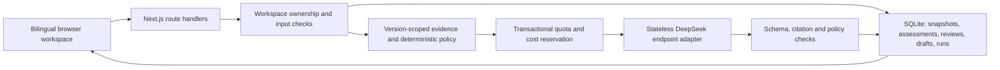

# Data, decision policy, and architecture

航衡 · AeroContext supports a fictional airline's operations coordinator in reviewing a simulated disruption, identifying what must be checked, drafting communications, and recording the review. It is not connected to real flight operations or weather systems.

## Provenance and calculations

The authoritative input is `HackSHSID 2026/Track 3 Data.xlsx`.

SHA-256: `571894e4d5ec64d661713c1f7e013f799f47356ccffe3e490cac73e1ae1cb5d6`.

The importer preserves original values, source worksheet, row, airport, period, and simulation/quality metadata in `src/data/competition.json`. The workbook remains unchanged. The supplied output and feedback examples remain source examples; they are not presented as this app's completed work.

| Evidence | Scope | Permitted interpretation |
|---|---|---|
| Current scenario report | Its stated airport and applicable scenario period | Qualified evidence for current risk, subject to reliability and conflicts |
| Monthly operations | One airport and month | Historical completion and release-normality context |
| Monthly weather | One airport and month | Historical weather context; flagged missing values are unusable as ordinary weather facts |
| Annual scale | One airport and year | Airport scale and historical business-importance context |
| Operating rules | Supplied rule ID and original row | Review, communication, authority, and stopping constraints |
| Team-added report | Explicit simulated provenance, reviewer-provided metadata | Current evidence only when its scope and reliability support that use |

For assessed month \(m\), the historical completion mean uses the preceding twelve available observations, excluding \(m\). When fewer exist, the actual number used and window are shown. The first workbook month preserves its supplied self-initialization while clearly showing zero preceding observations.

The supplied peer mean is an unweighted average of the same airport category in the same month, including the assessed airport. The category sizes are two, three, and three airports. The importer verifies these calculations against supplied rounded values.

Completion and airport release normality remain separate measures. Differences are **percentage points**, not relative percentage changes. A completion decline of at least five percentage points triggers focused historical review; it does not establish current high risk, a delay, or weather causation.

Four weather rows retain numeric source cells but carry a missing-weather flag: Qinglan March 2025, Gaoyuan September 2025, Hailing November 2025, and Linjiang November 2025. The flag takes precedence.

An optional historical cutoff excludes later monthly records and annual periods that have not ended. With no cutoff, history is explicitly retrospective context. Relative event times such as “Day 4” are not assigned invented calendar dates.

## Risk and decision authority

The risk classifier is a transparent prototype policy, not a calibrated probability model.

| Rating | Current prototype requirement |
|---|---|
| Unable to assess | No adequate usable current signal, or material source reliability is unavailable |
| Low | Affirmative stable-condition evidence and no conflicting current report |
| Medium | At least one usable current weather, operations, or capacity warning |
| High | At least two distinct warning types from distinct underlying reports and independent groups, with verification basis, timestamps, matching current period, and possible expansion of impact |

Reports outside the scenario period are context. Human-verified reports need a stated verification basis. Simply choosing a “verified” label without a basis does not make a report usable. Report labels and separate table names do not establish independence.

Risk and decision restrictions are separate fields:

- **RULE007:** cancellation, release, dispatch, maintenance, compensation, and similar professional decisions require the responsible professional. A supported medium rating remains medium.
- **RULE012:** a safety issue or inability to establish material source reliability stops action conclusions and requires referral. Evidence insufficiency determines an unable-to-assess rating; the stop itself does not automatically change a supported rating.
- When either restriction applies, generated action kinds are limited to referral and information preparation. A RULE012 assessment must carry stopped status.

The model receives the computed policy and explains it. It cannot silently substitute a different risk code or remove a restriction. Human reviewers can correct the underlying incident, preserve the old assessment, and generate a new version.

Business importance is retained for human prioritization and explanation. It does not independently manufacture evidence for a high risk classification. Wording-based professional-request detection and manually entered source metadata are prototype limitations requiring release evaluation.

## Application architecture

The API key remains in the server environment. An opaque HttpOnly cookie identifies a workspace; the database stores its hash. Queries check workspace ownership before reading or changing incident data.

Incident updates append immutable snapshots. Generation binds to one snapshot and records its configuration and usage. Completion from an older snapshot remains in history but cannot become the current assessment. Reviews and draft edits append records. Historical citations resolve against the historical snapshot.

Discussion does not mutate incident facts. The user must apply a proposal explicitly; it becomes an unverified report in a new snapshot and triggers reassessment. Further verification requires an explicit editor update with provenance.

The provider adapter supports stateless Responses requests and a separately selected Chat Completions compatibility format. Only Responses has been exercised live at this checkpoint. Reasoning content is discarded; only final answer text, terminal metadata, and usage accounting are retained.

The generated schema constrains evidence, metric, and rule IDs to the available values. Post-generation validation independently checks IDs, scope, required rules, risk/authority flags, restricted action kinds, and selected prohibited claims. One repair is allowed. Transport failure, truncation, or failed repair preserves the last valid result.

## Required output mapping

| Supplied field | Stored representation |
|---|---|
| Event ID | Incident ID; source event ID where applicable |
| Generation time | Assessment `generatedAt` |
| Risk | `riskLevel` |
| Airport/time scope | `scope` and bound snapshot |
| Rationale | `rationale` with fact/assumption/unknown labels and citations |
| Possible impact | `possibleImpacts` |
| Assumptions | `assumptionsToVerify` |
| Information gaps | `informationGaps` |
| First action | `firstAction` |
| Subsequent actions | `subsequentActions` |
| Escalation conditions | `escalationConditions` |
| Required human decisions | `humanDecisions` and decision constraints |
| Operations message | `drafts.operations` |
| Airport coordination message | `drafts.airportCoordination` |
| Passenger draft | `drafts.passenger` |
| References | `evidenceReferences`, per-claim citations, and `ruleIds` |
| Output status | `outputStatus` |

Every narrative is stored in English and Chinese with shared canonical codes. Manual editing of one draft language flags the other language for translation review.

## Nine feedback fields

The review record stores incident ID, recommendation ID, disposition, modification/rejection reason, final action, outcome, next improvement, reviewer alias, and review timestamp. It additionally binds to the exact assessment and explicitly distinguishes pending outcomes from simulated observed outcomes.

The original recommendation remains in its assessment. Rejecting or editing it does not overwrite history. Incorporating prior review context directly into future model requests is still pending; incident fact corrections already use the versioned workflow.

## Limits requiring evaluation

Resolvable citations do not prove the prose is supported by them. Current numeric checks verify referenced metric identity but do not fully compare every number in free text. Rule keywords are not a complete semantic safety classifier. This is why the final plan requires bilingual public cases, held-out scenarios, claim review, and independent human feedback before release claims.

New input is screened locally and at the API boundary before storage/model submission. Detected data requires masking/removal or a recorded false-positive decision for text that is not personal information; human approval cannot override RULE011. The original competition rule is unchanged. These review records are audit data and are not supplied as model evidence.
