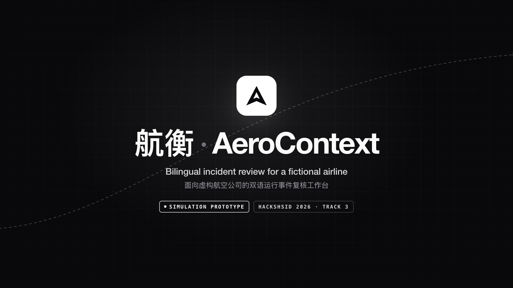

# Approved promo/demo video

[Watch or download the 1080p video](https://github.com/zha-chicken/runway-incident-workspace/releases/download/submission-2026-10-24/AeroContext-promo-1080p60.mp4)

Created by Claude and watched/approved by the project owner on 24 October 2026. The MP4 is unchanged from the approved copy: 110.15 seconds, 1920×1080, H.264, 60 fps, AAC stereo. Captions are bilingual. SHA-256: `8a49f8dd00ea37a814c49fd7da1930a8aa85b83ae46d27dbd017e13a3810c68a`.

Footage shows application `8ad14e3`. One QING assessment was recorded live (87 seconds, shown as a labeled time-lapse); it reused the disclosed UNSEEN02/D02 scenario. Other chapters use earlier saved model outputs and synthetic decisions in a separate app/database copy. These are demonstration recordings, not an additional untouched holdout or evidence of current-version clean-install verification. Simulation/draft labels remain visible.

The creator reports that music and interface sounds were synthesized by the project's `music.py` without third-party audio. The original creator README is included as [dated provenance](creator-provenance.md); build scripts and live databases are not part of the release. The recording's later call/cost is separate from frozen evaluation totals.
